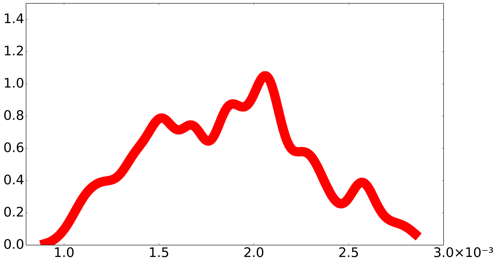

# Example economy

We consider a simple production-based model with an AK production technology along with adjustment costs. Our production framework includes two investment opportunities. While one of the investments is the commonly modeled investment in augmenting a broadly based capital stock, the second is an investment in R&D. Climate change is incorporated via damages induced by global warming. A successful R&D discovery eliminates carbon emissions from production, limiting any additional future climate damages.

Important components of our model specifications are two types of Poisson events, a *damage information event* that reveals the economic implications for further increases in global warming and the *technology discovery*. There are $L$ possible initial jump realizations, with $\ell = 1, \ldots, L-1$ pertaining to the damage implications for further increases in global warming and $L$ denoting the final possible realization pertaining to the technology discovery.

Our model specification is highly stylized, which makes calibration challenging; but we do intend our computations to be meaningful and revealing. Given the stylized nature of our model specification, a more formal and complete calibration is not feasible. As a consequence, the model outcomes we report should be thought of as illustrations of potentially important mechanisms.

(production)=
## Production and innovation

### Output

Output is split between consumption and two different types of investment with distinct intertemporal contributions to production: a conventional capital investment, $I^k_t$, and an investment in R&D, $I^r_t$:

$$
C_t + I^k_t + I^r_t = \alpha K_t \left[ 1 - \phi_0 \left( B_t \right)^{\phi_1} \right]
$$

for $\phi_1 \ge 2$ and $0 \le \phi_0 \le 1$. Superscripts $r$ and $k$ denote investment type. The notation $B_t$ is defined by

$$
B_t \overset{\mathrm{def}}{=} \left( 1 - \frac{\mathcal{E}_t}{\beta \alpha K_t} \right) \mathbf{1}_{\{ \mathcal{E}_t \le \beta \alpha K_t \}},
$$

where $\mathbf{1}$ is an indicator function that assigns one to the event in the $\{ \cdot \}$ brackets.

Emissions $\mathcal{E}_t$ are a proxy for a "dirty" energy input into production. We restrict the energy input to be nonnegative ($\mathcal{E}_t \ge 0$). When emissions fall short of the threshold $\beta \alpha K_t$, there is a corresponding convex adjustment in the output given by the right-hand side of the output constraint. For instance, one could imagine a fixed proportions technology for energy and capital, where dirty energy reduction less than the required proportion of capital must be replaced by a clean alternative subject to a convex "abatement cost." In this case, $B_t$ is a measure of emissions abatement.

We feature the case in which $\phi_1 = 3$. We suppose initially that $\phi_0 > 0$ and that at some future point a fully green technology becomes economically viable, in which case $\phi_0^L = 0$ and dirty energy is no longer needed to produce output.

### Productive capital evolution

The stock of productive capital, $K_t$, evolves as

$$
dK_t = K_t \left[ -\mu_k + \frac{I^k_t}{K_t} - \frac{\kappa}{2} \left( \frac{I^k_t}{K_t} \right)^2 \right] dt + K_t \sigma_k dW_t,
$$

where $\sigma_k$ is a row vector with the same dimension as the underlying Brownian motion. The new investment $I^k_t$ augments the capital stock $K_t$, subject to an adjustment cost captured by the curvature parameter $\kappa$.

### R&D capital evolution

A process $R$ captures the stock of R&D-induced knowledge capital and evolves as

$$
dR_t = -\zeta R_t dt + \psi_0 \left( I^r_t \right)^{\psi_1} \left( R_t \right)^{1 - \psi_1} dt + R_t \sigma_r dW_t,
$$

where $0 < \psi_1 < 1$ and $I^r_t$ is an investment in research and development. The parameter $\zeta$ captures potential depreciation in the stock of knowledge pertinent for future technological progress. The term $\sigma_r dW_t$ reflects an exogenous stochastic inflow of information on the future likelihood of a technological advance. We impose that $\sigma_r \cdot \sigma_k = 0$ making the stochastic increments in the two types of capital uncorrelated. The jump intensity for a new discovery $\mathcal{J}^L(R_t)$ is proportional to the knowledge stock $R$. We denote the constant of proportionality by $\chi$, so that $\mathcal{J}^L(R_t) = \chi R_t$. We refer to the resulting jump as a *technology jump*.

(climate)=
## Climate dynamics

Here we follow the simplified climate dynamics used in Brock and Xepapadeas (2017) and Barnett, Brock, and Hansen (2022). Their approach is based on an approximation from the geoscience literature used to support model comparisons. Specifically, Matthews, Gillett, Stott, and Zickfeld (2009) and others have purposefully constructed an approximation for climate model output:

$$
\textrm{temperature anomaly } (Y_t) \approx \textrm{TCRE } (\theta) \times \textrm{cumulative emissions},
$$

where TCRE is an acronym for the **T**ransient **C**limate **R**esponse to cumulative **E**missions.

Our specific form is given by

$$
dY_t = \mathcal{E}_t \left[ \theta dt + \varsigma dW_t \right]
$$

where $\theta$ is obtained from the set $\Theta$ of TCREs implied by alternative climate models. The term $\varsigma dW_t$ captures short-term climate sensitivity fluctuations. We impose that $\sigma_k \cdot \varsigma = \sigma_r \cdot \varsigma = 0$ making the stochastic increments in the temperature anomaly and the two types of capital uncorrelated. Figure 1 gives a smoothed histogram of the $\theta$'s used in our computations.

  

Figure 1: Smoothed density for the exponentially weighted (over horizon) responses of temperature to an emissions pulse based on input from 144 different models denoted by $\theta \in \Theta$ for $|\Theta| = 144$. The computations are based on an exponential decay rate matching the discount rate $\delta = .01$.

For baseline probabilities across the alternative climate models, we assign to each model the same subjective probability. For tractability, we abstract from parameter learning, as learning about such parameters is challenging given the underlying model complexities and has been historically slow. Rather than choose a particular $\theta$, we use weighted averages of the $\theta$'s across the different climate models based on a form of robust model averaging as is described in {ref}`Confronting uncertainty <robust-averaging>`.

(damage)=
## Damage functions

We assume that consumption, $C_t$, is diminished proportionately by climate change damages, $N_t$. Damages follow a piecewise log quadratic function of the temperature anomaly $y$. We assume a *damage information event* not only reveals the damage curvature for more extreme temperature changes, but it also induces a discrete increase in the logarithmic derivative, $d\hat{n}/dy$, in accordance with one of $L-1$ possible specifications. Formally, the derivative of logarithmic damages $\hat{n}$ with respect to the temperature anomaly is:

$$
\frac{d \hat{n}}{dy} =
\begin{cases}
\lambda_1 + \lambda_2 y, & \text{pre damage information event} \\
\lambda_1 + \lambda_2 \left( y - \hat{y} + \overline{y} \right) + \lambda_3(\ell)(y - \hat{y}), & \text{post damage information event}
\end{cases}
$$

for $\ell = 1, \ldots, L-1$, where $\hat{y}$ denotes the temperature anomaly when the damage information event takes place. The threshold $\overline{y}$ denotes the upper limit on $\hat{y}$. The value of $\lambda_3$ is initially latent, but is subsequently revealed through the realization of a damage information event as captured by $\lambda_3(\ell)$ and $\hat{y}$. Integrating, we construct the log damage function:

$$
\hat{n}(y) =
\begin{cases}
\lambda_1 y + \dfrac{\lambda_2}{2} y^2, & \text{pre damage event} \\
\lambda_1 y + \dfrac{\lambda_2}{2} \hat{y}^2 +
\dfrac{\lambda_2}{2} (y - \hat{y} + \overline{y})^2 +
\dfrac{\lambda_3(\ell)}{2} (y - \hat{y})^2 -
\dfrac{\lambda_2}{2} \overline{y}^2, & \text{post damage event}
\end{cases}
$$

### Intensity function

The intensity function governing this jump is given by

$$
\mathcal{J}^n(y) =
\begin{cases}
0, & 0 \le y \le \underline{y} \\
\mathsf{d}_0 \exp\left[
\frac{\mathsf{d}_1}{2} (y - \underline{y})^2 +
\frac{\mathsf{d}_2}{2} (y - \overline{y})^{-2}
\right] -
\mathsf{d}_0 \exp\left[
\frac{\mathsf{d}_2}{2} (\underline{y} - \overline{y})^{-2}
\right], & \underline{y} < y < \overline{y}
\end{cases}
$$

where $\underline{y}$ denotes the lower bound for when the damage information event can occur. The ${\sf d}_2$ term guarantees that the damage information event occurs prior to the temperature anomaly reaching $\overline{y}$.

<iframe
  id="plotly-intensity"
  src="../_static/intensity_interactive.html"
  title="Intensity function of the damage information event"
  width="100%"
  height="500"
  scrolling="no"
  style="display:block; margin:0 auto; border:none;"
></iframe>

Given that such an event takes place there are $L-1$ possible damage curves that could be realized, each with equal probability. Curve $\ell$ has intensity:

$$
\mathcal{J}^{\ell}(y) = \left( \frac{1}{L-1} \right) \mathcal{J}^n(y), \qquad \ell = 1, 2, \ldots, L-1.
$$

We refer to each of these jumps as a damage curvature jump; the damage information event is the collection of these $L-1$ potential jumps.

### Range of damage functions

Figure 2 displays the damage functions included in our analysis.

<iframe
  id="plotly-damage"
  src="../_static/damage_interactive.html"
  title="Range of possible damages for alternative damage function curvature realizations with jump realizations at temperature anomalies of 1.75 and 2.25 degrees Celsius"
  width="100%"
  height="620"
  scrolling="no"
  style="display:block; margin:0 auto; border:none;"
></iframe>

Figure 2: Range of possible damage functions for two cases with different temperature thresholds. Formally, the vertical axis measures $\exp(-\hat{n})$. The solid curves show the average values, and the shaded regions give the range of possible values for $\exp(-\hat{n})$, representing the remaining fraction of the economy's capacity to produce consumption. We constructed this figure for $\underline{y} = 1.5$ and $\overline{y} = 2.5$. The red curve and region show the potential damage functions when the damage information event occurs at $Y_t = \hat{y} = 1.75$. The blue curve and region show the potential damage functions when the event occurs at $Y_t = \hat{y} = 2.25$.

The sliders set $\hat{y}$ for the green case and pick a single damage curve $\lambda_3(\ell)$, drawn as a dashed line.

Notice that an early occurrence of the damage information event is in part "bad news" in our specification due to the more extreme concavity of the damage function, in contrast with a late occurrence.

(preferences)=
## Social planner preferences

We adopt a recursive representation of preferences in continuous time for the planner. We start by forming the forward-looking continuation value, $V_t$, under risk for each calendar date, $t$:

$$
\begin{align*}
V_t &= \delta \int_0^\infty \exp(-\delta u) \mathbb{E} \left[ \left( \log C_{t+u} - \log N_{t+u} \right) \mid \mathfrak{F}_t \right] du \\
&= \delta \int_0^\tau \exp(-\delta u) \mathbb{E} \left[ \left( \log C_{t+u} - \log N_{t+u} \right) \mid \mathfrak{F}_t \right] du + \exp(-\delta \tau) \mathbb{E} \left( V_{t+\tau} \mid \mathfrak{F}_t \right),
\end{align*}
$$

where $\mathfrak{F}_t$ reflects the date $t$ information available to the planner. Thus under risk, the preferences assume logarithmic utility in "damaged consumption", $C/N$. The following differential equation gives the local representation:

$$
0 = \delta \left( \log C_t - \log N_t - V_t \right) + \lim_{\tau \downarrow 0} \frac{1}{\tau} \left[ \mathbb{E} \left( V_{t+\tau} - V_t \mid \mathfrak{F}_t \right) \right].
$$

This equation becomes a Hamilton-Jacobi-Bellman (HJB) equation once we substitute a candidate value function expressed as a function of the state vector.

The representation deduced in this section assumes a unitary elasticity of substitution which we feature in most of our computations, although we do explore sensitivity to this modeling choice in Appendix F of the paper and in more detail in [Online Appendix M](11_online_m.md).

(model-spec)=
## State and control variables

In our computations that follow, we use the state variables:

$$
X_t \overset{\mathrm{def}}{=} \begin{bmatrix} \widehat{K}_t, \widehat{R}_t, Y_t \end{bmatrix}', \quad \text{where} \quad \widehat{K}_t \overset{\mathrm{def}}{=} \log K_t, \quad \widehat{R}_t \overset{\mathrm{def}}{=} \log R_t
$$

We have three controls:

$$
\frac{I^k_t}{K_t}, \qquad \frac{I^r_t}{K_t}, \qquad \mathcal{E}_t.
$$

The first two controls are expressed relative to capital to simplify the numerical analysis. In the social valuation formulas, we use damaged consumption as the numeraire. Consumption prior to damages is determined by the output constraint, and damages are given by:

$$
N_t = \exp\left[ \hat{n}(Y_t) \right].
$$

Consequently, consumption inclusive of damages (damaged consumption) satisfies:

$$
C^d_t \overset{\mathrm{def}}{=} \frac{C_t}{N_t} = \frac{K_t}{N_t} \left( \alpha \left[ 1 - \phi_0 \left( B_t \right)^{\phi_1} \right] - \frac{I^k_t}{K_t} - \frac{I^r_t}{K_t} \right).
$$

## Reproducing the figures

To reproduce Figures 1, 2, and 8, run the script below from the root of the code repository, as described in {ref}`Running the scripts <code-running>`. The script does not need any model solutions.

~~~~bash
bash ./sbatch/baseline_plot.sh
~~~~

After the run finishes, you should have output files named `Climate_Sensitivity.png`, `Temperature Anomaly.png`, and `Temperature Anomaly weighted.png` under `output/figures/<dataset>/baseline_plot/`, where `<dataset>` is the Coarse grid directory of the full model, as listed in {ref}`Grids <code-grids>`. Figure 8 appears on [A simplified model with only technology jumps](09_technology_only.md).

Source scripts:
* `sbatch/baseline_plot.sh`
* `python/frequency_plot.py`
