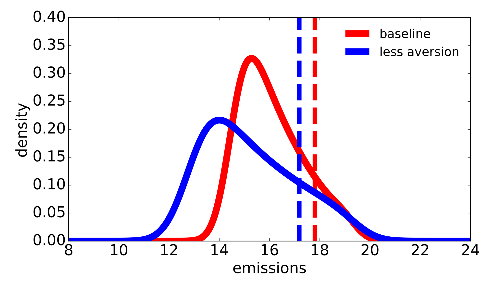
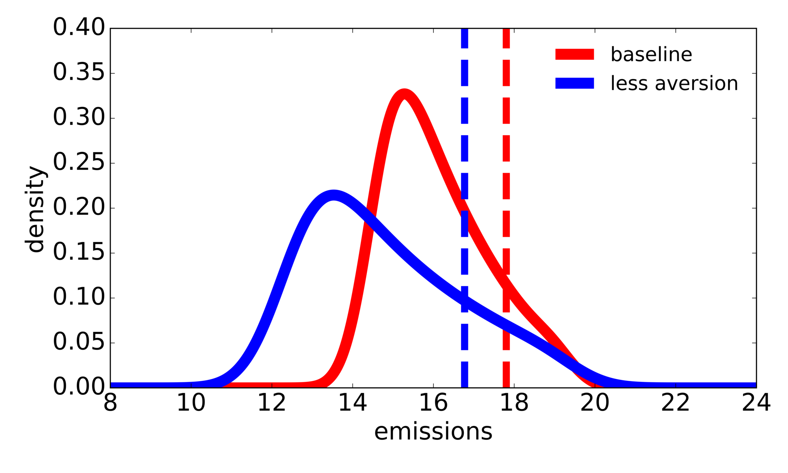
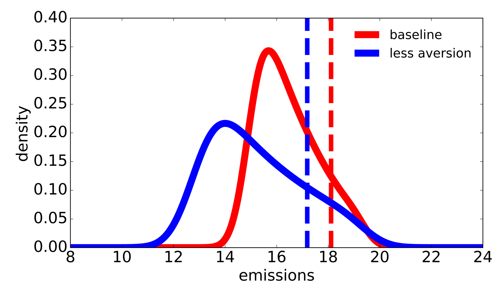
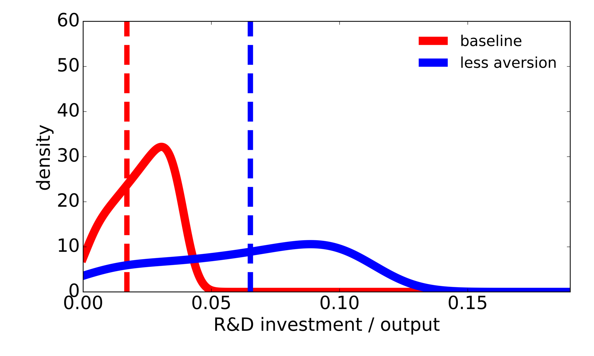
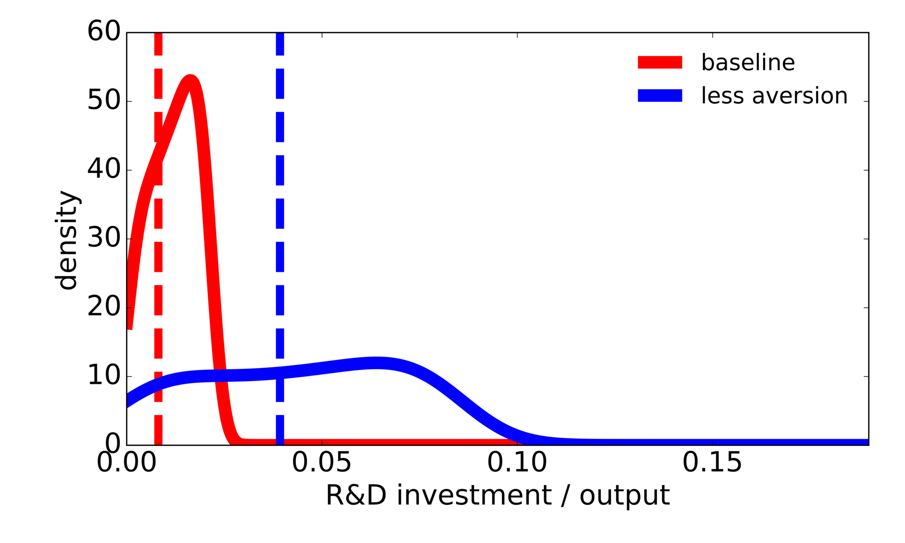

# Acting now or waiting?

Our damage information event reveals the tail of the damage function associated with more extreme warming of the environment. As usual with conditioning, responses depend on which damage curvature is revealed. The responses to this event reflect the uncertainty tradeoff between acting now versus waiting until there is more information. The damages we confront in the future could be very severe or possibly modest, giving a motive for waiting. On the other hand, if they turn out to be severe, it may be very costly to delay all action and an initial response based on this possibility could be prudent.

Figure 7 and Table 4 give the "before and after" emissions and R&D investment responses to a damage information event. For the sake of illustration, the figure and table consider two different state configurations at the time when the event occurs. In both cases we assume the event occurs at a temperature anomaly of two degrees Celsius (${\hat y} = 2$). We set capital stock and the knowledge stock to be the medians assuming no jump of any kind takes place in prior periods. We report results for the baseline specification and the less aversion specification ($\xi_m = .1$). While the capital stock is very similar, the knowledge stock is substantially higher for the second configuration. We report results imposing the corresponding initial conditions when depicting baseline and less aversion results. The dashed lines give the pre-event emissions and R&D investments, and smoothed densities show post-event responses across potential damage curvatures. Table 4 reports the pre-event values and the post-event median value and the minimum and maximum values across potential damage curvatures for R&D investment and emissions responses.

<div style="
     display:flex;
     gap:18px;
     justify-content:center;
     align-items:flex-start;
     flex-wrap:wrap;
">
  <figure style="margin:0; width:340px; max-width:100%;">
    
    <figcaption style="text-align:center; font-size:0.85em;">(a) Emissions</figcaption>
  </figure>
  <figure style="margin:0; width:340px; max-width:100%;">
    
    <figcaption style="text-align:center; font-size:0.85em;">(b) R&D investment</figcaption>
  </figure>
</div>

Figure 7: Robustly optimal emissions and R&D investment choices before and after a damage information event. Each case uses the median capital and knowledge stock values for no-jump simulations at ${\hat y} = 2^\circ$C under the respective uncertainty aversion specification. The median capital and knowledge stock values for the baseline case are $k=1505$ and $r=35$. The median capital and knowledge stock values for the less-aversion case are $k=1508$ and $r=56$. The post-damage information event policies are evaluated at $z=2.5$. Red curves depict the baseline responses and blue curves depict the less-aversion responses. The solid curves are Gaussian kernel densities of the 20 post-damage curvature jump outcomes, with equal weights and Scott's bandwidth multiplied by 0.8. The dashed vertical lines give the outcomes before the damage curvature jump. Emissions are reported in gigatons of carbon (GtC). R&D investment is reported as a ratio relative to output abstracting from the energy input ($\alpha K$).

Panel (a) of Figure 7 and columns 2–3 of Table 4 show the pre- and post-event emissions responses. Not surprisingly, there is considerable heterogeneity in the post-event emissions responses as the reactions become tailored to potential damages induced by more extreme global warming. With the uncertainty concerns ($\xi_m=.1$), Figure 7 shows that the response density shifts to the left. As reported in Table 4, the median post-event responses are substantially lower than the pre-event counterparts showing that there is indeed a "wait-and-see" aspect to our findings for emissions.

The pre- and post-event R&D investment responses are shown in panel (b) of Figure 7 and columns 4–5 of Table 4. As both the table and figure show, there is a very substantial amount of heterogeneity in the post-event responses, even more so than with emissions. Not only are the median post-event responses higher than the pre-event counterparts, but Figure 7 also shows that the spread in post-event responses is substantially amplified when the planner has uncertainty concerns ($\xi_m=.1$).

```{include} ../_static/table/table4_quantile_damage.md
```

(pre-post-comparison)=
## Pre- and post-damage information event comparison

This section is Appendix I of the paper.

<div style="
     display:flex;
     gap:18px;
     justify-content:center;
     align-items:flex-start;
     flex-wrap:wrap;
     max-width:700px;
     margin:0 auto;
">
  <figure style="margin:0; width:340px; max-width:100%;">
    
    <figcaption style="text-align:center; font-size:0.85em;">(a) Emissions, baseline median state</figcaption>
  </figure>
  <figure style="margin:0; width:340px; max-width:100%;">
    
    <figcaption style="text-align:center; font-size:0.85em;">(b) Emissions, less aversion median state</figcaption>
  </figure>
  <figure style="margin:0; width:340px; max-width:100%;">
    
    <figcaption style="text-align:center; font-size:0.85em;">(c) R&D investment, baseline median state</figcaption>
  </figure>
  <figure style="margin:0; width:340px; max-width:100%;">
    
    <figcaption style="text-align:center; font-size:0.85em;">(d) R&D investment, less aversion median state</figcaption>
  </figure>
</div>

Figure 12: Robustly optimal R&D investment and emissions before and after a damage information event for two different state variable scenarios. Each case uses the median capital and knowledge stock values for no-jump simulations at $2^\circ$C. Panels (a) and (c) use the median state values under the baseline solution. Panels (b) and (d) use the median state values under the less-aversion solution. The median capital and knowledge stock values for the baseline case are $k=1505$ and $r=35$. The median capital and knowledge stock values for the less-aversion case are $k=1508$ and $r=56$. The post-damage information event policies are evaluated at $z=2.5$. Red curves depict the baseline responses and blue curves depict the less-aversion responses. The solid curves are Gaussian kernel densities of the 20 post-damage curvature jump outcomes, with equal weights and Scott's bandwidth multiplied by 0.8. The dashed vertical lines give the outcomes before the damage curvature jump. Emissions are reported in gigatons of carbon (GtC). R&D investment is reported as a ratio relative to output abstracting from the energy input ($\alpha K$). For the baseline median state initialization, pre-jump R&D investment is .017 and .065 and emissions are 17.80 GtC and 16.77 GtC under the baseline and less aversion policy responses, respectively. For the less aversion median state initialization, R&D investment is .0081 and .0392 and emissions are 18.11 GtC and 17.19 GtC under the baseline and less aversion policy responses, respectively.

```{include} ../_static/table/table32_two_states.md
```

## Reproducing the figures and tables

To reproduce Figures 7 and 12 and Tables 4 and 32, run the scripts below from the root of the code repository, as described in {ref}`Running the scripts <code-running>`. They redraw the figures and rebuild the tables from the policy values stored in `output/experiments/no_jump_temperature/two_states_2c/control_values.csv`. These values were computed from the {ref}`full model solutions <code-full-model>` on the Fine grid and are part of the code repository, so the scripts need no new solves. The experiment that computed them is described in `python/experiments/no_jump_temperature/README.md`, `python/experiments/no_jump_temperature/common_state_neutrality/README.md` and `python/experiments/no_jump_temperature/two_states_2c/README.md`. Each script submits Slurm jobs and returns at once, so start each script only after the jobs of the previous one have finished.

~~~~bash
bash ./sbatch/experiments/no_jump_temperature/submit_damage_density_panels.sh --ratio
bash ./sbatch/experiments/no_jump_temperature/submit_damage_density_panels.sh --respective-states
bash ./sbatch/update_results.sh --model full_model --grid-profile double_resolution --figure7-panels-only --no-compile
bash ./sbatch/update_results.sh --model full_model --grid-profile double_resolution --table4-only --no-compile
~~~~

After the run finishes, you should have output files named `emissions_respective_states.png` and `rd_respective_states.png` (Figure 7) under `output/experiments/no_jump_temperature/figure7_panels/respective_states/no_dots/`, `emissions_state_neutrality.png`, `emissions_state_less_aversion.png`, `rd_state_neutrality.png`, and `rd_state_less_aversion.png` (Figure 12) under `output/experiments/no_jump_temperature/figure7_panels/ratio/no_dots/`, and `paper_pre_post.tex` (Table 4) and `paper_two_state_pre_post.tex` (Table 32) under `output/experiments/no_jump_temperature/figure7_panels/ratio/`. Copies of these files go to `results_in_paper/` as `Figure7_*.png`, `Figure12_*.png`, `Table4_quantile_damage.tex`, and `Table32_before_after_two_states.tex`.

Source scripts:
* `sbatch/experiments/no_jump_temperature/submit_damage_density_panels.sh`
* `sbatch/experiments/no_jump_temperature/run_damage_density_panels.sh`
* `sbatch/update_results.sh`
* `python/experiments/no_jump_temperature/figure7_panels/export_ratio.py`
* `python/experiments/no_jump_temperature/figure7_panels/respective_states.py`
* `python/experiments/no_jump_temperature/figure7_panels/plot.py`
* `python/experiments/no_jump_temperature/figure7_panels/table.py`
