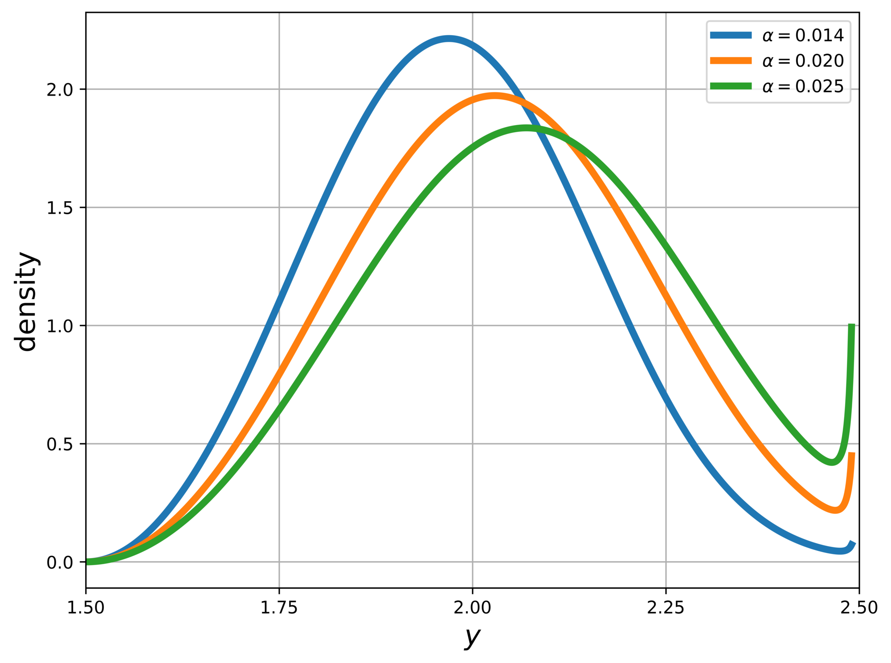
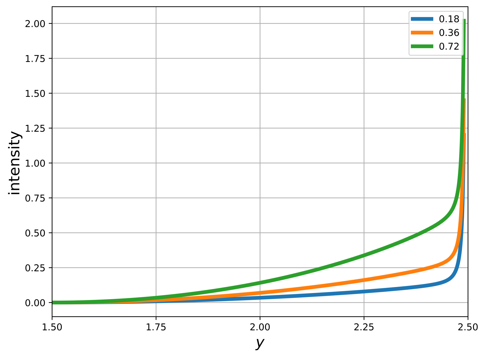
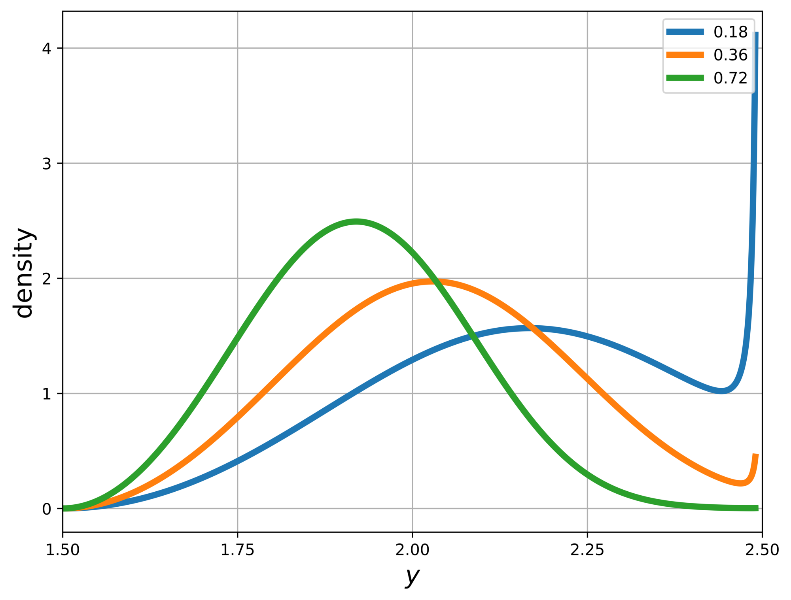

# P. Damage function jump intensity

Jump intensities imply densities over the possible success times. Here we illustrate implications for the damage information event. When the temperature anomaly is an increasing function of calendar time, a density over the potential time realizations of the event implies a corresponding density over the potential temperature anomalies that trigger the event, which we now illustrate.

Denote increasing temperature anomaly by $Y_t$ starting from an initial time $t = 0$. Then for a given intensity ${\mathcal J}$, the jump time distribution is:

$$
1 - \exp\left[ - \int_0^t {\mathcal J}(Y_s) ds\right]
$$

with a density given by:

$$
{\mathcal J}(Y_t) \exp\left[ - \int_{0}^{t} {\mathcal J}(Y_s) d{s} \right].
$$

With the familiar change of variables formula, we may compute a density over the alternative temperature anomalies.

For purposes of illustration, consider the special case in which

$$
Y_t = Y_{0} + \alpha t .
$$

Then the change-of-variables formula gives the following implied density over the temperature anomalies:

$$
\frac 1 \alpha {\mathcal J}(y) \exp\left[ - \frac 1 \alpha \int_{Y_{0}}^y {\mathcal J}({\tilde y}) d{\tilde y} \right]
$$

In the computations that follow, we consider three values for the temperature response in degrees Celsius per year: $\alpha = .014, .020, .025.$ As rough approximations, we took the .1, .5, and .9 quantiles of {ref}`Figure 1 <climate>` and combined them with an annual carbon emissions estimate of about 10.5 GtC per year based on Figueres et al. (2018).

Figure 16 gives the implied densities expressed in terms of the temperature anomaly for the three different values of $\alpha.$ Increasing (decreasing) $\alpha$ shifts the density to the right (left) and makes it less (more) peaked at the interior mode. Figure 17 reports the damage information event jump intensity function used in our calculations along with what happens when we double and halve $\mathsf{d}_1.$ Figure 18 shows the implied densities expressed in terms of the temperature anomaly. Increasing (decreasing) $\mathsf{d}_1$ shifts the density to the left (right) and makes it more (less) peaked at the interior mode.

We note that for Figures 16 - 18 we impose a numerical cutoff of $y = 2.49$ because the intensity function diverges as $y$ approaches $\overline{y} = 2.5$. While the density functions spike up near the upper boundary, we confirm that they do in fact tend to zero at $\overline{y} = 2.5$, as expected.

  

Figure 16: Damage information event jump densities for alternative $\alpha$'s.

  

Figure 17: Jump intensity functions for the damage information event for alternative values of $\mathsf{d}_1.$ We used $\mathsf{d}_1=.36$ in our calculations.

  

Figure 18: Damage information event jump densities for alternative $\mathsf{d}_1$'s. The parameter $\alpha = .020$ when generating these densities. We used $\mathsf{d}_1 = .36$ in our computations.

## Reproducing the figures

To reproduce Figures 16, 17, and 18, run the script below from the root of the code repository, as described in {ref}`Running the scripts <code-running>`. The script does not need any model solutions.

~~~~bash
bash ./sbatch/appendix_illustrations.sh
~~~~

After the run finishes, you should have output files named `d_alpha.png` (Figure 16), `intensity_d_1_sensitivity.png` (Figure 17), and `density_d_1_sensitivity.png` (Figure 18) under `output/figures/<dataset>/appendix_illustrations/`, where `<dataset>` is the Coarse grid directory of the full model, as listed in {ref}`Grids <code-grids>`. Their legends differ slightly from the paper figures in position and labels. The same run also writes Figures 13, 14, and 15 of [Comparison to a real options formulation](10_real_options.md).

Source scripts:
* `sbatch/appendix_illustrations.sh`
* `python/appendix_illustrations.py`
